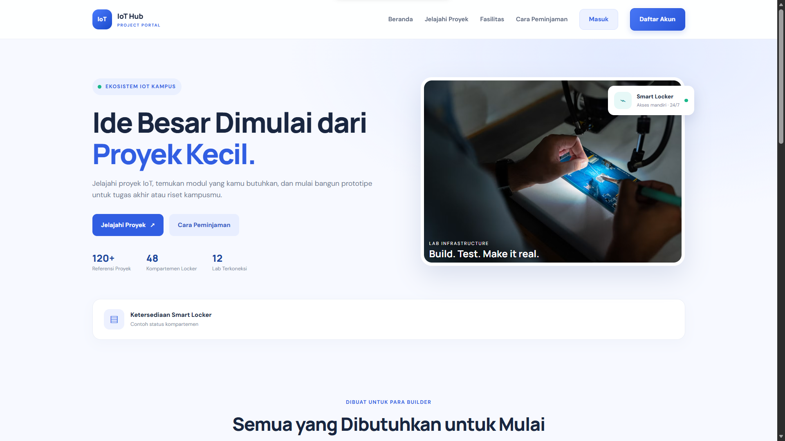
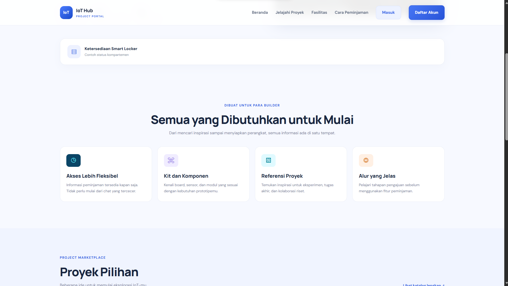
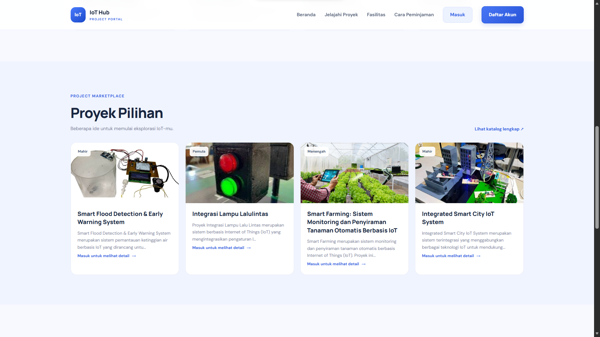
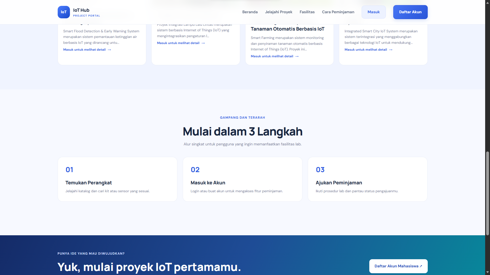
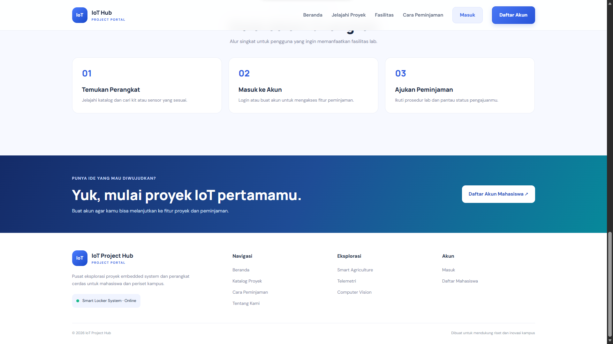

# IoT Project Hub

## Tentang Proyek

**IoT Project Hub** merupakan platform berbasis web yang dikembangkan
sebagai pusat informasi dan eksplorasi proyek Internet of Things (IoT)
di lingkungan kampus. Platform ini dirancang untuk membantu mahasiswa
menemukan inspirasi proyek, mengenal perangkat dan komponen yang dapat
digunakan, serta memperoleh informasi mengenai fasilitas laboratorium
dan prosedur peminjaman perangkat.

Proyek ini mengangkat tema **Platform Kolaboratif Ekosistem IoT
Kampus**. Tema tersebut dipilih karena pengembangan proyek IoT
membutuhkan akses terhadap referensi, perangkat, komponen, dan fasilitas
pendukung. Melalui satu platform, informasi tersebut dapat disajikan
dengan lebih terstruktur sehingga mahasiswa dapat mempersiapkan kegiatan
praktikum, tugas akhir, maupun riset dan eksperimen.

## Tujuan Proyek

1.  Menyediakan tempat untuk melihat dan mencari referensi proyek IoT.
2.  Memudahkan mahasiswa mengenali kit, sensor, board, dan komponen yang
    sesuai dengan kebutuhan proyek.
3.  Menyajikan informasi fasilitas laboratorium, termasuk ketersediaan
    Smart Locker.
4.  Memberikan informasi mengenai alur dan prosedur pengajuan peminjaman
    perangkat.
5.  Mendukung kegiatan belajar, eksperimen, dan kolaborasi mahasiswa di
    bidang IoT.

## Fitur Utama

-   **Katalog Proyek:** Menampilkan berbagai referensi proyek IoT
    beserta deskripsi dan tingkat kesulitannya.
-   **Kit dan Komponen:** Menjadi sarana informasi mengenai perangkat
    dan komponen untuk membuat prototipe IoT.
-   **Informasi Fasilitas:** Menampilkan informasi fasilitas
    laboratorium dan ketersediaan Smart Locker.
-   **Panduan Peminjaman:** Menjelaskan tahapan penggunaan fasilitas dan
    pengajuan peminjaman perangkat.
-   **Akun Pengguna:** Menyediakan akses akun agar pengguna dapat
    melanjutkan ke fitur proyek dan peminjaman.

## Target Pengguna

Platform ini ditujukan terutama untuk mahasiswa, khususnya mahasiswa
yang mempelajari bidang teknologi informasi, elektronika, dan Internet
of Things. Platform juga dapat dimanfaatkan oleh pengelola laboratorium
untuk menyampaikan informasi fasilitas dan perangkat yang tersedia.

## Dokumentasi Landing Page

Berikut merupakan screenshot tampilan landing page IoT Project Hub yang
telah dikembangkan.

### 1. Bagian Hero / Halaman Utama

Bagian pembuka landing page memperkenalkan IoT Project Hub sebagai
portal proyek IoT kampus. Pengguna dapat langsung memilih menu untuk
menjelajahi proyek atau melihat panduan peminjaman. Bagian ini juga
menampilkan ringkasan informasi proyek, kompartemen locker, dan
laboratorium.

### 2. Fitur yang Ditawarkan

Bagian ini menjelaskan manfaat utama platform, seperti akses informasi
peminjaman, pengenalan kit dan komponen, referensi proyek, serta panduan
alur penggunaan fasilitas.

### 3. Proyek Pilihan

Bagian proyek pilihan menampilkan beberapa contoh referensi proyek IoT,
seperti sistem deteksi banjir, integrasi lampu lalu lintas, smart
farming, dan smart city. Pengguna dapat menjelajahi proyek untuk
memperoleh inspirasi sebelum mengembangkan prototipe sendiri.

### 4. Alur Penggunaan Platform

Bagian ini menjelaskan tahapan awal bagi pengguna, yaitu menemukan
perangkat yang dibutuhkan, masuk ke akun, kemudian mengajukan peminjaman
sesuai prosedur laboratorium.

### 5. Ajakan Bergabung dan Footer

Pada bagian akhir landing page terdapat ajakan untuk membuat akun agar
pengguna dapat melanjutkan ke fitur proyek dan peminjaman. Footer memuat
deskripsi singkat platform serta tautan navigasi dan eksplorasi.

## Tema Proyek Kolaboratif

Tema **Platform Kolaboratif Ekosistem IoT Kampus** berfokus pada
penyediaan ruang digital yang menghubungkan mahasiswa dengan informasi
proyek, perangkat, komponen, dan fasilitas laboratorium. Melalui IoT
Project Hub, mahasiswa diharapkan dapat lebih mudah menemukan ide,
menyiapkan kebutuhan prototipe, dan mengetahui prosedur pemanfaatan
fasilitas yang tersedia.

Proyek ini juga mengangkat semangat kolaborasi karena pengembangan IoT
tidak hanya membutuhkan kemampuan pemrograman, tetapi juga pemahaman
perangkat keras, integrasi sistem, pengujian, dan kerja sama
antaranggota tim. Dengan adanya platform ini, proses pencarian referensi
dan informasi pendukung kegiatan proyek dapat dilakukan melalui satu
tempat yang lebih mudah diakses.

## Penutup

IoT Project Hub diharapkan dapat menjadi media pendukung kegiatan
pembelajaran dan pengembangan proyek IoT di lingkungan kampus. Dengan
menggabungkan katalog referensi proyek, informasi perangkat, fasilitas
laboratorium, dan panduan peminjaman, platform ini berupaya menciptakan
ekosistem yang lebih terorganisasi dan mendukung inovasi mahasiswa.
